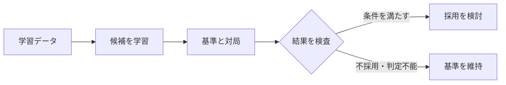

  
SHOGI AI × AI AGENT

  <h1>将棋AIの開発を AIに任せる</h1>
  
実験の自動化を試してわかったこと

  
講演スライド 試作

<!--
将棋AIの改善実験を題材に、AIエージェントとツールの役割分担を紹介します。
これは構成と表示を確認するための試作です。
-->

---

01 / SHOGI AI

# 将棋AIは、先を読み局面を評価する

  

01
<h2>探索</h2>
候補となる手と、 その先の局面を読む

  

02
<h2>評価関数</h2>
読んだ先の局面が どれくらい良いかを評価する

NNUEは、局面を高速に評価するニューラルネットワークの一種

<!--
探索が先の展開を読み、評価関数がその局面の良さを見積もります。
この講演では評価関数の学習と、その改善を確かめる実験に注目します。
-->

---

02 / EXPERIMENT

# 学習した候補は、本当に強い？

学習の損失が下がっただけでは、棋力が上がったとは言えない

<!--
学習で得られた候補を、対局条件をそろえて基準と比較します。
不採用や判定不能も結果として記録します。図は説明用に簡略化しています。
-->

---

03 / AUTOMATION

# 実験の一連の作業を `/goal` で進める

  
<b>01</b>計画・実装
<i>→</i>
  
<b>02</b>学習・対局
<i>→</i>
  
<b>03</b>結果確認・採否
<i>→</i>
  
<b>04</b>記事・通知

Codexが計画と判断を担い、実験ツールやJenkinsを使う。 長時間処理後の再開など、人が確認する場面もある。

<!--
実験計画の立案から、実装、実験、結果の確認と採否、ブログ執筆、メール通知までを進めるGoalを開発しました。
長時間・反復処理は必要に応じてJenkinsで実行し、pauseした場合は人が状態を確認して再開します。
-->
