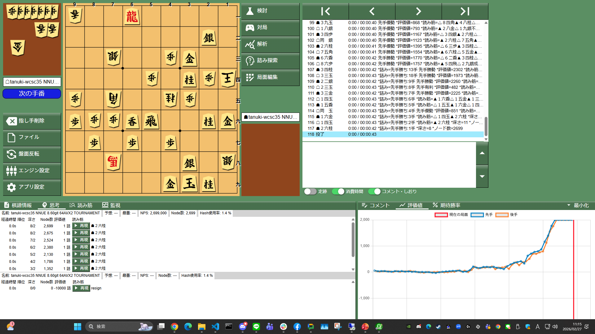

<div class="cover">
  <h1>将棋 AI を開発する AI を<br>AI に開発させる話</h1>
  <div class="tag">野田 久順</div>
</div>

<!--
将棋AIを改良する実験を、AIエージェントとどう進めるかをお話しします。最初に将棋AIの仕組みを紹介し、その後、実験を回すために試した構成と現在の役割分担を説明します。
-->

---
layout: section
---

# 1. 自己紹介

---

<div class="eyebrow">1. 自己紹介</div>

# 野田 久順


**ザイオソフト コンピューター将棋サークル**

- 2017年　第5回将棋電王トーナメント 優勝
- 2021年　CSA貢献賞 受賞
- 2024年　第34回世界コンピュータ将棋選手権 優勝
- 2026年　CSA貢献賞 独創賞 受賞

<!--
コンピュータ将棋の開発に携わってきました。今回はエンジンの改良に加え、改良案を繰り返し検証する仕組みを取り上げます。
-->

---

<div class="eyebrow">1. 自己紹介</div>

# 今日持ち帰ってほしいこと

<div class="two-cards">
  <div class="card"><h2>将棋AIの仕組み</h2><p>探索部・評価部</p></div>
  <div class="card"><h2>将棋AIの改良方法</h2><p>仮説検証をAI・プログラム・人で<br>どう分担するか</p></div>
</div>

<!--
将棋 AI の基礎を紹介したあと、改良にかかる手間、試した構成とその結果、残った課題をお話しします。最後に質疑応答の時間を取ります。
-->

---
layout: section
---

# 2. 将棋 AI

---

<div class="eyebrow">2. 将棋 AI</div>

# 将棋AI

<div class="shogihome-example">
  <div>
    <div class="card"><h2>入力</h2><p>局面</p></div>
    <div class="card"><h2>出力</h2><p>推奨手・評価値・読み筋</p></div>
  </div>
  <figure>
    <div class="shogihome-capture">
      
    </div>
    <figcaption>ShogiHomeの表示例。<br>左下に思考結果、右下に評価値の推移。</figcaption>
  </figure>
</div>

<!--
左上の盤面が、エンジンに渡す局面の例です。左下の思考欄には読んだ手順が、右下には対局を通じた評価値の変化が出ています。推奨手と評価値はエンジンや持ち時間で変わります。次は初期局面に戻り、▲７六歩などの候補から指し手を選ぶ過程を見ていきます。
-->

---

<div class="eyebrow">2. 将棋 AI</div>

# ゲーム木

<div class="game-tree-example">
  <ul>
    <li>合法手による局面遷移を木構造で表現したもの</li>
    <li>原理的にゲームのすべての状態遷移を<br>表現できる</li>
    <li>すべての分岐を探索すると、双方が最善手を<br>選び続けた場合の結果を特定できる<ul><li><strong>「ゲームを解く」</strong></li></ul></li>
  </ul>
  <GameTree class="game-tree-diagram" />
</div>

<!--
図の上が初期局面です。合法手を一つ選ぶたびに別の盤面に進み、そこから相手の手が枝分かれします。図では一部の枝を省略しています。すべての分岐を終局まで調べて結果を根元へ戻すと、双方が最善を尽くした場合の結果を求められます。
-->

---

<div class="eyebrow">2. 将棋 AI</div>

# 探索量から見たゲームの複雑さ

<div class="game-complexity">
  <div>
    <p>ゲームを解くための探索局面数は、<br>ゲームの複雑さの目安になる。</p>
    <div class="complexity-formula">探索局面数 ≈ <var>N</var><sup><var>M</var></sup></div>
    <ul>
      <li><var>N</var> : 1局面あたりの平均合法手数</li>
      <li><var>M</var> : 終局までの平均手数</li>
    </ul>
    <div class="callout">将棋のように分岐が多いゲームでは、<br>現実的な時間内に全探索できない。</div>
  </div>
  <table>
    <thead><tr><th>ゲーム</th><th>探索局面数の目安</th></tr></thead>
    <tbody>
      <tr><td>チェッカー</td><td>10<sup>30</sup></td></tr>
      <tr><td>オセロ</td><td>10<sup>60</sup></td></tr>
      <tr><td>チェス</td><td>10<sup>120</sup></td></tr>
      <tr><td>中国象棋</td><td>10<sup>150</sup></td></tr>
      <tr class="shogi-row"><td>将棋</td><td>10<sup>220</sup></td></tr>
      <tr><td>囲碁</td><td>10<sup>360</sup></td></tr>
    </tbody>
  </table>
</div>

<!--
前のページのゲーム木で、毎回2通りの手があると仮定すると、2手先は4局面、10手先は1,024局面です。表は元の講演資料の概算で、平均的な枝分かれと対局の長さから、大きさの桁を比べています。同じ盤面に至る別々の手順も、ゲーム木では別の枝として数えます。将棋AIは持ち時間の中で読む範囲を絞ります。次はその探索と評価を見ていきます。
-->

---

<div class="eyebrow">2. 将棋 AI</div>

# 探索と評価

<div class="search-evaluation">
<div>

- **探索**: 一定の手数まで先を読む。
  - 人間の「読み」に相当する。
- **評価**: 読んだ先の局面の有利・不利を<br>見積もる。
  - 人間の「大局観」に相当する。

</div>

<figure>

```mermaid {scale: 0.72, themeCSS: '.flowchart-link { stroke: #60847c; } .marker { fill: #60847c; stroke: #60847c; }'}
%%{init: {"flowchart": {"curve": "basis", "rankSpacing": 46, "nodeSpacing": 12, "htmlLabels": false}}}%%
flowchart TD
  A[3] --> B1[3]
  A --> B2[1]
  B1 --> C1[7]
  B1 --> C2[3]
  B1 --> C3[5]
  B2 --> C4[2]
  B2 --> C5[4]
  B2 --> C6[1]

  C2 -.-> B1
  C6 -.-> B2
  B1 -.-> A

  classDef score fill:#f8f7f2,stroke:#60847c,color:#152c31,font-size:26px,font-weight:700;
  classDef selected fill:#e0f0eb,stroke:#60847c,color:#152c31,font-size:26px,font-weight:700;
  class A,B1,C2,C6 selected;
  class B2,C1,C3,C4,C5 score;
```

<figcaption>□は局面、中の数字は評価値。<br>実線は指し手、点線は応手を考慮した評価を<br>手前の局面へ戻す流れ。</figcaption>
</figure>
</div>

<!--
図では点数が高いほど自分に有利とします。実線に沿って2手先まで読み、いちばん下の局面を評価します。相手は自分にとって不利な手を選ぶと考えるので、左の候補では7・3・5のうち3、右の候補では2・4・1のうち1が残ります。自分の手番では3と1を比べ、3になる左の手を選びます。
-->

---

<div class="eyebrow">2. 将棋 AI</div>

# CPUエンジンとGPUエンジン

<div class="cpu-gpu-comparison">

| 項目 | CPUエンジンの代表例 | GPUエンジンの代表例 |
|---|---|---|
| 探索アルゴリズム | アルファ・ベータ法 | PUCT |
| 評価関数 | NNUE評価関数 | 深層学習モデル |
| 探索速度 | 速い | 遅い |
| 評価精度 | 低い | 高い |
| 得意な局面の傾向 | 終盤 | 序盤 |
| 主な将棋AI | やねうら王・水匠・tanuki- | dlshogi |

<p>探索速度・評価精度・得意な局面は、モデルや対局条件によって変わる。</p>
</div>

<!--
表は元講演で紹介した代表的な構成です。CPU中心の例は、軽い評価を繰り返して多くの局面を読みます。GPU中心の例は、深層学習モデルで有力な手と局面の価値を推定しながら探索します。NNUEも学習したニューラルネットワークです。ここでは対局中の構成を比べており、評価関数の学習に使う装置は別に考えます。このあとの実験の説明では、CPUで探索とNNUE評価を行う構成を取り上げます。
-->

---

<div class="eyebrow">2. 将棋 AI</div>

# 棋力向上のための改良候補

<div class="change-grid">
  <div class="card"><h2>探索</h2><p>手を読む順序・枝刈り</p></div>
  <div class="card"><h2>評価関数</h2><p>特徴量・ネットワーク構造</p></div>
  <div class="card"><h2>学習</h2><p>学習データ・学習条件</p></div>
  <div class="card"><h2>実行時の工夫</h2><p>時間配分・高速化</p></div>
</div>

<!--
探索なら、有力そうな手を先に読む方法を試せます。評価関数なら入力の表現や構造を変えられます。学習ではデータや設定を変え、実装では同じ評価をより速く計算するよう工夫できます。
-->

---

<div class="eyebrow">2. 将棋 AI</div>

# 自己対局による棋力向上の判断

<div class="callout mb-5">
  変更前と変更後のバージョンを自己対局させる。<br>
  対局結果から、レーティングが統計的に有意に向上したかを判定する。
</div>

| 決めること | 選択肢 |
|---|---|
| 開始局面 | 平手の初期局面 / 互角局面集から選ぶ |
| 持ち時間 | 短い持ち時間 / 長い持ち時間 |
| 終了条件 | 対局数固定 / SPRT（逐次確率比検定） |

<!--
同じ開始局面で先後を入れ替え、両バージョンに同じ持ち時間を設定します。互角局面集を使うと、先後の形勢が近いさまざまな局面から試せます。固定対局数では、予定した対局が終わってから結果を判定します。SPRTでは、対局結果がたまるたびに、事前に決めた統計的な停止基準に達したかを確認します。

SPRTの参考資料（チェスエンジンの検証例） https://official-stockfish.github.io/docs/fishtest-wiki/Fishtest-Mathematics.html
-->

---
layout: section
---

# 3. 将棋 AI の改良にかかる手間

---

<div class="eyebrow">3. 将棋 AI の改良にかかる手間</div>

# 将棋 AI の開発の流れ

<ol class="development-steps">
  <li>仮説</li>
  <li>実験計画</li>
  <li>実装</li>
  <li>実験</li>
  <li>結果確認</li>
  <li>採否の判断</li>
  <li>記録</li>
</ol>

<!--
学習時の誤差が減ると、教師データによりよく合ったことが分かります。棋力への効果は、対戦相手と条件を決めて確かめます。この一連の手順を変更案ごとに繰り返します。
-->

---

<div class="eyebrow">3. 将棋 AI の改良にかかる手間</div>

# 将棋 AI の開発で人が担う作業

- 将棋 AI のどこを、どう変えるか考える
- 変更の効果を試せるように実装する
- 実験プログラムを実行する
- 実験結果を確認し、変更を採用するか判断する
- 実験条件・結果・採否を記録する

<div class="callout">変更案を試すたびに一連の作業を繰り返すため、人の手間がかかる。</div>

<!--
手作業で開発を進める場合、変更案を考えるところから、試すための実装、実験の実行、採否の判断と記録まで、人が一つずつ進めます。別の変更案を試すたびに、この作業を繰り返します。
-->

---
layout: section
---

# 4. 解決方法

---

<div class="eyebrow">4. 解決方法</div>

# Coding Agent による開発の自動化

仮説を立てるところから、実験結果を記録するところまで自動化する。

<ol class="development-steps">
  <li>仮説</li>
  <li>実験計画</li>
  <li>実装</li>
  <li>実験</li>
  <li>結果確認</li>
  <li>採否の判断</li>
  <li>記録</li>
</ol>

<!--
前の章で示した7つの工程を、Coding Agent で自動化することを考えました。改良の仮説を立て、実験を計画し、変更を実装します。学習や対局を実行したあと、結果を確認して変更の採否を判断し、実験条件・結果・採否を記録します。
-->

---

<div class="eyebrow">4. 解決方法</div>

# 開発を自動化する仕組みの開発

<div class="callout">仕組みの設計・実装にも Coding Agent を使った。</div>

<p class="detail">複数の構成を試し、各工程をどのように進めるかを検討した。</p>

<!--
Coding Agent には、実験の各工程を進める役割に加え、そのための仕組みを設計・実装するときにも協力してもらいました。次のページでは、仕組みの検討に使ったスキル集を紹介します。
-->

---

<div class="eyebrow">4. 解決方法</div>

# Shaping Skills を使った設計

Shape Up の考え方を、AI と一緒に設計を進めるための手順にしたスキル集。

| 工程 | 内容 |
|---|---|
| Shaping | 課題と要件を整理し、構成案を比較する |
| Breadboarding | 選んだ案の操作や処理のつながりを具体化する |
| Slicing | 動作を確認できる小さな単位に分け、実装する順番を決める |
| 実装 | Coding Agent と一緒に、決めた単位ごとに作り、動作を確認する |

[rjs/shaping-skills（GitHub）](https://github.com/rjs/shaping-skills)

<!--
元のリポジトリでは Claude Code 向けに公開されています。Shaping では、まず「何を自動化したいか」を明らかにして、その要件に照らして構成案を比較します。Breadboarding では、案を具体化するために、誰が何を操作し、プログラムがどう動くかを整理します。Slicing では、具体化した案を、一つずつ動作を確認できる単位に分けます。その計画をもとに、Coding Agent と一緒に実装を進めます。次のページでは、将棋 AI の開発を自動化するために検討した構成を紹介します。参照先のリポジトリは現在アーカイブされています。
-->

---

<div class="eyebrow">4. 解決方法</div>

# どんな構成を試したか

| 構成 | 計画・判断 | 実行・待機 |
|---|---|---|
| Goalから直接実行 | Coding Agent | 既存ツールを起動して待機 |
| 専用プログラムと<br>Coding Agent | Coding Agent が<br>計画を提案 | 専用プログラムが工程を管理 |
| 専用プログラムと Web UI | Coding Agent と<br>専用プログラム | コントローラーが実行し、<br>ブラウザで操作・進捗確認 |
| Jenkinsと分担 | Coding Agent | 長い処理をJenkinsへ渡す |

<!--
これは構成ごとの比較です。一部の仕組みは複数の構成で使われ、実装段階やバージョンによって分担も変わりました。
-->

---

<div class="eyebrow">4. 解決方法</div>

# Goalから直接実行

<p class="goal-workflow-intro">Coding Agent が <code>/goal</code> の指示に沿って、計画から採否の判断・記録まで進める。</p>

<div class="steps">
  <div><span>実験計画・実装</span></div><i>→</i>
  <div><span>実験ツールの起動</span></div><i>→</i>
  <div><span>終了の待機</span></div><i>→</i>
  <div><span>結果の判定・記録</span></div>
</div>

<div class="callout">
  長時間の実験では、Coding Agent が終了を繰り返し確認する。<br>
  確認のたびにトークンを消費する。
</div>

<!--
この構成では、Coding Agent が変更案に沿って実装し、学習や対局に使う既存のツールを直接起動します。実験が終わったら、同じ Goal の中で結果を確認し、変更の採否を判断して記録します。終了確認の間隔とトークン消費の関係は、後の「Goalの待機にかかるコスト」で説明します。
-->

---
class: deterministic-workflow
---

<div class="eyebrow">4. 解決方法</div>

# 専用プログラムと Coding Agent

専用プログラムを作り、必要な工程で Coding Agent を起動する構成を検討した。

| 工程 | 専用プログラムの処理 |
|---|---|
| 1. 準備 | Coding Agent を起動し、実験の計画と実装を任せる |
| 2. 実験 | 実験計画と実装を検証し、実験を実行する |
| 3. 採否 | 実験結果を基準に照らして判定する |
| 4. 記録 | 実験結果と採否を記録する |

<div class="callout" style="margin-top: 16px; padding-block: 8px;">
  状態管理や例外時の復旧まで設計を詰めるうちに、実装範囲が広がった。<br>
  現実的な時間内に実装を終えられなかった。
</div>

<!--
旧版では、Coding Agent による実験計画の作成とプログラムによる検証・保存を実機で確認しました。その後、Coding Agent に候補の実装を任せ、プログラムが差分やビルドを検証する処理も試作しました。初期案には、結果を渡して Coding Agent に採否を判断させる設計がありました。後の設計では、採否はプログラムがルールに沿って確定し、Coding Agent は結果の解釈や説明を担当します。表は検討した構成を示しています。この旧構成で、実験の準備から採否の確定・記録まで本番で一巡したことは、調査した履歴からは確認できませんでした。
-->

---

<div class="eyebrow">4. 解決方法</div>

# 専用プログラムと Web UI

コントローラーが実験を進め、人がブラウザで操作する構成を検討した。

<div class="change-grid">
  <div class="card"><h2>ブラウザで操作</h2><p>実験の開始・変更・停止・再開</p></div>
  <div class="card"><h2>ブラウザで確認</h2><p>学習・対局結果</p></div>
</div>

<div class="callout">
  リグレッションテストに数十分かかるようになり、開発が進まなくなった。
</div>

<!--
実験の進行はコントローラーが担当する計画でした。停止要求を受けたら実行中のジョブの結果を確認し、次の工程を始める前に止めます。応答が途切れたときは、同じ要求 ID で状態を照会して、二重に起動しないようにします。

開始・通常停止・再開のブラウザ操作は模擬環境で検証しました。調べた履歴では、実機で実験から公開・通知まで一巡したことは確認できませんでした。手元ではテスト1回に数十分かかることがあり、履歴にも、編集中は対象試験に絞って統合・配備前に全体回帰を行う方針へ見直した記録があります。
-->

---

<div class="eyebrow">4. 解決方法</div>

# Jenkinsと分担

Jenkins は、ビルドやテストなどをジョブとして実行する自動化サーバー。

<div class="steps">
  <div><span>Goalが<br>ジョブを起動</span></div><i>→</i>
  <div><span>必要に応じて<br>Goalを一時停止</span></div><i>→</i>
  <div><span>Jenkinsが<br>実行・通知</span></div><i>→</i>
  <div><span>人が確認して<br>再開</span></div>
</div>

<div class="callout">実行中のトークン消費を抑えられる。実行後の再開は手動で行わなければならない。</div>

<!--
この構成では、学習や対局など、時間のかかる実験を Jenkins のジョブとして実行します。利用者が指定した場合は Goal を一時停止します。終了通知を受けたら、対象のジョブと Goal の停止状態を確認して再開します。

参考資料 [Jenkins 公式ドキュメント](https://www.jenkins.io/doc/#what-is-jenkins)
-->

---
layout: section
---

# 5. 結果

---

<div class="eyebrow">5. 結果</div>

# 改善判定を通過した変更

| 変更 | 長時間対局数 | 結果 |
|---|---:|---|
| [初期学習率を10分の1にして追加学習](https://nodchip.hatenablog.com/entry/goal-20260909-171439-3292c923) | 12,520 | 採用 |
| [学習時に共通の駒特徴を追加して継続学習](https://nodchip.hatenablog.com/entry/goal-20260911-135550-9efd36a9) | 11,832 | 採用 |

<!--
それぞれ、実験開始時点で採用されていた追加学習前のモデルと比較しました。共通の駒特徴は、玉の位置が異なる局面の間でも、同じ駒の情報を共有して学ぶための補助です。長時間対局は40秒、1手ごとに0.4秒加算。逐次検定に使った+4 Eloは仮説の値です。
-->

---

<div class="eyebrow">5. 結果</div>

# 現在の役割分担

| 担当 | 役割 |
|---|---|
| Coding Agent | 仮説と実験計画を組み立て、結果を検査して採否を判断 |
| 既存ツール・小さなRust補助 | 学習、対局、実行の記録や確認 |
| Jenkins | 実験計画に沿って実験プログラムを実行 |
| 人 | Goalを再開、停止理由、必要な承認 |

<!--
短い確認には既存ツールを使い、長時間・反復処理にはJenkinsを使う運用です。再開が必要なときは、ジョブの終了とGoalの状態を人が照合します。
-->

---
layout: section
---

# 6. 自動化後に残った課題

---

<div class="eyebrow">6. 自動化後に残った課題</div>

# Jenkins ジョブ終了後の自動再開

<p class="goal-workflow-intro">一時停止した <code>/goal</code> を、ジョブ終了後に自動再開するようにしようとした。</p>

<div class="callout">
  Coding Agent 「承認待ちや安全停止の状態では、<br>
  必要な確認や承認が済むまで再開できません。」
</div>

<p class="detail">自動再開は見送り、人が停止理由を確認してから再開する運用にした。</p>

<!--
Jenkins のジョブが終わっても、Goal が承認待ちや安全停止で止まっている場合があります。プログラムで再開する仕組みは試作しましたが、必要な確認や承認を済ませずに再開することはできないと Coding Agent に指摘されました。そこで、ジョブの終了通知を受けた人が停止理由を確認し、再開できる状態なら手動で再開する運用にしました。
-->

---

<div class="eyebrow">6. 自動化後に残った課題</div>

# 非公開データ

<div class="steps">
  <div><span>あるデータを<br>非公開のものだと伝えた</span></div><i>→</i>
  <div><span>データの解析を<br>依頼した</span></div><i>→</i>
  <div><span>自動承認の審査で<br>停止した</span></div>
</div>

<div class="callout">
  自動審査で、非公開データを Coding Agent のサーバーに送信できないと<br>判断された。
</div>

<p class="detail">
  「ブログや GitHub の公開リポジトリにアップロードしないでください」と<br>
  ブラックリスト方式で指示した。
</p>

<!--
私が非公開と伝えたデータの解析を依頼したところ、自動承認の審査で、そのデータを Coding Agent のサーバーに送信できないと判断され、処理が止まりました。これは個別の経験として紹介します。
次に、データの扱いとして、ブログや GitHub の公開リポジトリへのアップロードを禁止すると具体的に指示しました。今回の審査では、解析に必要な Coding Agent のサーバーへの送信が可能になりました。
-->

---
layout: section
---

# 7. まとめ

---

<div class="eyebrow">7. まとめ</div>

# まとめ

- 将棋 AI の開発をする AI を開発した。
- AI の開発に AI を使用した。
- 自動開発での棋力の向上を確認した。

<!--
将棋 AI の改良では、変更前後の自己対局で棋力への効果を確かめます。今回は、追加学習の学習率を下げた変更と、学習時に共通の駒特徴を追加した変更の2例を紹介しました。

仮説から記録までの作業を Coding Agent に任せ、その仕組みの設計・実装にも Coding Agent を使いました。直接実行では終了確認にトークンを消費し、専用プログラムや Web UI の案では、状態管理や復旧、テストまで含めて開発の負担が広がりました。現在は既存ツールを使い、長い処理は Jenkins に任せています。実験を再開する前の確認と承認、非公開データをどこに送ってよいかの判断は、引き続き人が担います。
-->

---

<div class="cover">
  <h1>質疑応答</h1>
  <p>ありがとうございました。</p>
</div>

<!--
将棋AIの改良、実験の比較条件、Coding Agent と Jenkins の役割分担など、ご質問をお願いします。
-->
